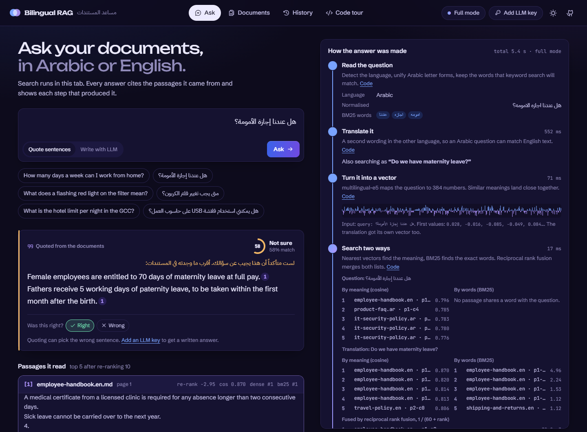
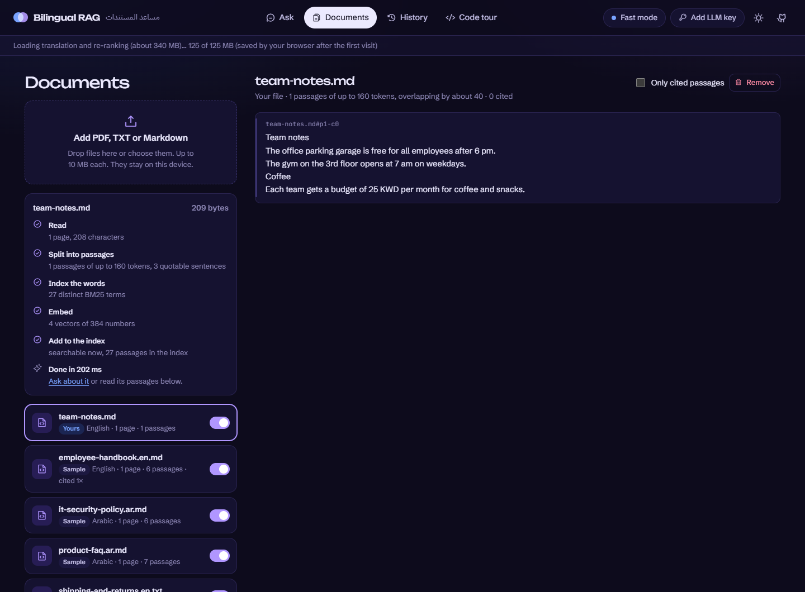
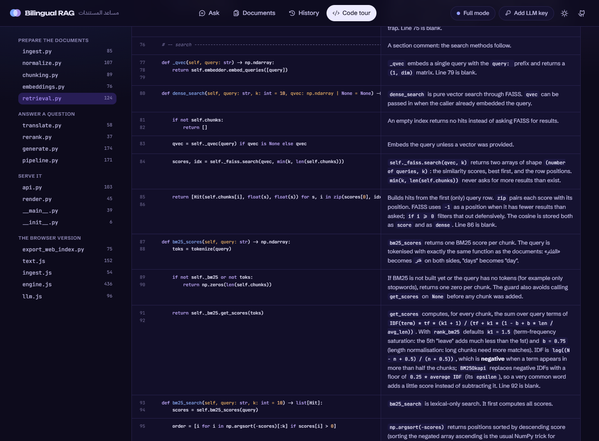
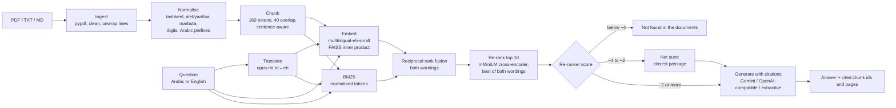

# Bilingual RAG Assistant — Arabic / English document Q&A with citations

Ask questions in **Arabic or English** about a set of documents and get an answer that **cites the exact passages** it
comes from, or an honest "not found in the documents". Hybrid retrieval (multilingual embeddings + BM25 with
Arabic-aware normalisation), Arabic↔English query translation, cross-encoder re-ranking, and a pluggable generator
(Gemini, any OpenAI-compatible model, or a no-key extractive fallback), with an evaluation on 46 answerable and 24
unanswerable bilingual questions.

**▶ [Live demo](https://nardy11.github.io/bilingual-rag-assistant/)**: runs entirely in your browser, with no server.
Upload your own PDFs, watch every step of retrieval for each answer, read the cited passages inside their documents,
keep a history with confidence and right/wrong marks, and add a Gemini or OpenAI key to have an LLM write the answer.
A **[code tour](https://nardy11.github.io/bilingual-rag-assistant/#code)** explains every line of the project next
to the code. It answers within a second in *fast mode*. The translation and re-ranking models (about 340 MB,
cached after the first visit) then load in the background, and *full mode* answers in about 3 to 6 s.

[](https://nardy11.github.io/bilingual-rag-assistant/)
[](https://github.com/Nardy11/bilingual-rag-assistant/actions/workflows/ci.yml)


[](LICENSE)



## What it does

- **Ingests PDF, TXT and Markdown** (pypdf), cleans the text, joins PDF line wraps, and splits it into
  sentence-aware chunks of at most 160 tokens of the embedding model's own tokenizer, with 40 tokens of overlap.
- **Normalises Arabic for matching**: removes tashkeel and tatweel, unifies alef forms (أ إ آ ٱ → ا), alef maqsura
  (ى → ي), taa marbuta (ة → ه) and hamza seats, maps Arabic-Indic digits, and strips the article and attached
  prefixes (ال، وال، بال…). Displayed text is never altered.
- **Retrieves with three methods**: dense (FAISS, `multilingual-e5-small`), BM25 (`rank_bm25`), and both fused with
  reciprocal rank fusion. A multilingual cross-encoder then re-ranks the top 10.
- **Crosses languages by translating the question.** «هل عندنا إجازة الأمومة؟» is also searched as "Do we have
  maternity leave?" (MarianMT `opus-mt-ar-en` / `opus-mt-en-ar`). The two result lists are fused, and each passage is
  re-ranked against both wordings, keeping the better score.
- **Answers with citations**, `[1]`, `[2]`, each pointing at a chunk id (`travel-policy.en.pdf#p2-c0`) and a page.
- **Says how sure it is, in three bands:** a confident answer; *"Not sure this answers it. The closest passage in
  the documents says:"* followed by the quote; or "Not found in the documents" / «لم أجد الإجابة في المستندات» only
  when nothing comes close. See [Confidence](#confidence-why-three-bands-and-not-a-threshold).
- **Serves it** as a FastAPI service (`/ingest`, `/ask`), a Docker image, a Gradio app for Hugging Face Spaces, and a
  static GitHub Pages demo that runs the same retrieval in the browser with transformers.js.

## The browser app

[`docs/`](docs) is a static site (GitHub Pages) that runs the same pipeline with transformers.js:

| View | What you can do |
|---|---|
| **Ask** | Ask in Arabic or English. A trace shows each step as it runs: the normalised words, the translation, the 384-number question vector, the dense, BM25 and fused rankings, the re-ranker's re-ordering, where the score falls in the confidence bands, and how the answer was picked (sentence scores, or the exact prompt sent to the LLM). |
| **Documents** | Drop in PDF, TXT or Markdown files. Each one is read (pdf.js), cleaned, chunked with the model's own tokenizer, embedded and indexed on your device, with every step shown. Read any document passage by passage, with the passages and sentences that answers cited marked, and switch documents in or out of the search. |
| **History** | Your last 100 questions with their answers, match confidence and generator. Mark answers right or wrong and the page reports your measured accuracy. Download it as JSON. |
| **Code tour** | Every line of `rag/`, the export script and the browser engine, with a note next to it explaining what it does and why. Start from the path a document takes or the path a question takes. |
| **LLM key** | Gemini, OpenAI or any OpenAI-compatible endpoint. The key goes only to that provider, straight from the tab, with the same prompt as the Python service. Without a key, answers are quoted sentences. |

Match confidence is the top re-ranker score (or cosine in fast mode) mapped onto one scale: below the "not found"
floor is under 40 %, the "not sure" band is 40 to 75 %, "sure" is 75 % and up. It measures how well the best passage
matches the question, not whether the answer is right; the right/wrong marks in History measure that.





## Architecture



## Evaluation

Three question sets, all in [`eval/`](eval):

- `questions.jsonl`: **30 questions, 15 in Arabic and 15 in English**, carefully worded. 8 of them are
  **cross-lingual**: an English question whose answer sits in an Arabic document, or the other way round.
- `natural_questions.jsonl`: **16 short, conversational cross-language questions**, the way people actually type
  them («هل عندنا إجازة الأمومة؟», "how long is the warranty"). 10 are Arabic about English documents, and 6 the
  other way round. This set was added after the first demo refused «هل عندنا إجازة الأمومة؟» even though it had
  ranked the right passage first.
- `unanswerable.jsonl`: **24 questions the documents don't answer**: off-topic ("who won the world cup") and
  plausible-but-missing policies ("Do we have a pension plan?").

Each answerable question has a gold document, a gold evidence span and a short gold fact. A retrieved chunk counts
as gold if it comes from the gold document and contains the evidence span (compared after normalisation).
Reproduce with `python eval/run_eval.py`; raw per-question output is in [`eval/results.json`](eval/results.json).
CPU timings are from a Windows laptop (Ryzen 7 7435HS).

**Retrieval** (26 chunks, k = 10):

| Retriever | Recall@1 | Recall@5 | MRR@10 | R@5 EN | R@5 AR | R@5 cross-lingual | Natural R@1 | Natural R@5 | ms/query |
|---|---|---|---|---|---|---|---|---|---|
| BM25 | 0.63 | 0.77 | 0.689 | 0.80 | 0.73 | 0.12 | 0.00 | 0.06 | 0 |
| Dense (e5-small) | 0.70 | 0.90 | 0.795 | 0.93 | 0.87 | 0.75 | 0.25 | 0.69 | 25 |
| Hybrid (RRF) | 0.67 | 0.87 | 0.753 | 0.93 | 0.80 | 0.62 | 0.19 | 0.69 | 30 |
| Hybrid + rerank | 0.90 | 0.97 | 0.933 | 1.00 | 0.93 | 0.88 | 0.69 | 0.81 | 562 |
| **Hybrid + translate + rerank** (default) | 0.93 | **1.00** | **0.961** | 1.00 | 1.00 | **1.00** | 0.56 | **1.00** | 1960 |

**End to end with the extractive generator** (no LLM, top 5 passages):

| Pipeline | Set | Answered | Answered, sure | Answer has the gold fact | Cites a gold passage |
|---|---|---|---|---|---|
| Extractive, hybrid | 30 questions | 1.00 | 0.83 | 0.73 | 0.77 |
| Extractive, hybrid | 16 natural | 1.00 | 0.44 | 0.19 | 0.25 |
| Extractive, hybrid + rerank | 30 questions | 1.00 | 0.93 | 0.87 | 0.93 |
| Extractive, hybrid + rerank | 16 natural | 0.88 | 0.44 | 0.56 | 0.62 |
| **Extractive, translate + rerank** (default) | 30 questions | **1.00** | **1.00** | **1.00** | **1.00** |
| **Extractive, translate + rerank** (default) | 16 natural | 1.00 | 0.62 | **0.69** | **0.81** |

**Confidence bands** (46 answerable, 24 unanswerable questions):

| Pipeline | Signal | Floor / sure | Answerable: sure · not sure · refused | Unanswerable: sure · not sure · refused |
|---|---|---|---|---|
| Extractive, hybrid | top cosine | 0.76 / 0.82 | 32 · 14 · 0 | 0 · 20 · 4 |
| Extractive, hybrid + rerank | re-ranker score | −4 / −2 | 35 · 9 · 2 | 2 · 4 · 18 |
| **Extractive, translate + rerank** (default) | re-ranker score | −4 / −2 | **40 · 6 · 0** | 4 · 10 · 10 |

What the numbers say:

- **Short cross-language questions were the real weak spot**, and the original 30-question set hid it. With
  hybrid retrieval alone, the right passage is first for only 3 of the 16 natural questions (0.19), and the
  extractive answer contains the fact for 3 of 16.
- **The cross-encoder is the big win**: recall@1 on the 30 questions goes from 0.67 to 0.90–0.93, and on the
  natural questions every gold passage lands in the top 5 once translation is added.
- **Translation mostly helps the answer, not the ranking.** Natural recall@1 is slightly *lower* with translation
  (0.56 vs 0.69), because a weak translation ("حج" → "pilgrimage" instead of "Hajj") can promote a wrong passage.
  But end-to-end answers improve (fact in the answer 0.56 → 0.69, gold citation 0.62 → 0.81), the 30-question set
  becomes perfect, and no answerable question is refused any more. Both legs stay in, and the trade-off is reported.
- **BM25 cannot cross languages** on its own (0.12 cross-lingual R@5). With translation it gets a same-language
  query to match, which is part of why translation helps.
- **Re-ranking 10 candidates instead of 20** gave the same or better quality at half the cost: natural fact 11/16 vs
  9/16, no answerable question refused, and 10 of 24 off-topic questions refused instead of 8. That's why
  `RERANK_POOL = 10`.
- The sets are small (46 + 24 questions over 26 chunks), so differences of one question are noise.

### Confidence: why three bands and not a threshold

The first version refused any question whose best passage had cosine < 0.80 to the question. That gate was
calibrated on 4 unanswerable questions, and it failed in practice. «هل عندنا إجازة الأمومة؟» had the maternity
passage ranked **first**, but scored 0.783 and was refused. On the full sets, **no single cut-off separates
answerable from unanswerable questions**, on either signal:

- top cosine (e5 squeezes almost everything into 0.75–0.90): answerable min 0.783, unanswerable max 0.813;
- re-ranker score: at any threshold either real questions are refused or off-topic ones are answered (best
  accuracy about 88%).

So the score now decides **how sure the answer sounds**, not only whether there is one. The floor (−4 for the
re-ranker, 0.76 for cosine) is set so that none of the 46 answerable questions is refused. Above it, the answer is
shown with its citations. Between the floor and the "sure" line it is prefixed with *"Not sure this answers it.
The closest passage in the documents says:"*. A reader always sees the cited passage and can judge it.

The known cost: **4 of 24 unanswerable questions still get a confident answer** (e.g. "Is there free parking?",
whose closest passage scores high for no good reason), and 10 get a "not sure" quote. With an LLM generator
(`RAG_LLM=gemini` / `openai`), the prompt's own "reply exactly: not found" rule is the real second gate: the model
reads the passage, it does not just measure similarity. The bands are in `rag/pipeline.py` and can be overridden
with `RAG_MIN_SCORE`, `RAG_SURE_SCORE`, `RAG_MIN_CONFIDENCE` and `RAG_SURE_CONFIDENCE`.

## Design choices

**Why hybrid retrieval.** Embeddings handle paraphrase and cross-language questions; BM25 handles exact terms,
numbers and names that small embedding models blur. Reciprocal rank fusion combines the two rankings without
calibrating their score scales against each other. The evaluation shows where each one wins, and the cross-encoder
fixes the ordering that fusion gets wrong.

**Why `intfloat/multilingual-e5-small`.** It covers about 100 languages including Arabic, is among the strongest
multilingual retrievers of its size (118M parameters, 384 dimensions), and embeds a query in tens of milliseconds
on CPU. The same weights exist as an 8-bit ONNX export (`Xenova/multilingual-e5-small`), so the browser demo
embeds queries in exactly the vector space of the index precomputed in Python. Larger models (`bge-m3`,
`multilingual-e5-large`) retrieve better but are 5 to 20 times heavier and too large for a browser demo. They are
one environment variable away (`RAG_EMBED_MODEL`), but the confidence bands need re-calibrating. A quick check
of `multilingual-e5-base` on the natural cross-language questions did no better than e5-small (1 vs 2 of 13 ranked
first), so translation plus re-ranking was the better lever.

**Why `cross-encoder/mmarco-mMiniLMv2-L12-H384-v1` for re-ranking.** It is a multilingual MiniLM trained on
mMARCO (14 languages, Arabic included) and is small enough to re-rank 10 passages × 2 wordings on CPU in under a
second. Its repository ships quantized ONNX files, so the browser demo runs the very same model.

**Why translate the question.** A chunk usually covers several topics in one language: the maternity sentence sits
between sick leave and bereavement leave in the English handbook. Scored against the Arabic question, that chunk
looks only half relevant (−3.7). Scored against the English wording, it is clearly first (−2.7, next best −4.9).
The translators are MarianMT `Helsinki-NLP/opus-mt-ar-en` and `opus-mt-en-ar` (~300 MB each, CPU; ONNX exports
`Xenova/opus-mt-*` in the browser). Small MT models sometimes loop ("الدنيا : الدنيا : …"), so a translation
that is far longer than the question or mostly repeated words is dropped (`rag/translate.py:plausible`).

**Arabic handling.** Arabic spelling varies in practice: hamza on alef is often dropped, ة and ه, and ى and ي
are swapped, and tashkeel is sometimes present. Matching therefore runs on a normalised form, while the
displayed text stays exactly as written. The light prefix stripping (ال، وال، بال، لل…) lets «الإجازة» match
«إجازة» in BM25 without a full stemmer that would over-conflate roots. Sentence splitting knows the Arabic
question mark «؟», and the demo renders every passage and answer with `dir="rtl"` when it is Arabic.

**Pluggable generation.** `RAG_LLM=gemini` (needs `GEMINI_API_KEY`), `RAG_LLM=openai` (any `/chat/completions`
endpoint: OpenAI, Groq, Together, vLLM, Ollama via `OPENAI_BASE_URL`, `OPENAI_API_KEY`, `OPENAI_MODEL`), or
`extractive`. Without any key the extractive generator is used: it quotes the one or two sentences from the top 3
passages that best match the question (0.75 × cosine + 0.25 × term overlap), so every word of the answer is
traceable. The LLM prompt requires `[n]` citations and the question's language, and the cited ids are parsed back
out of the answer.

## Security hardening

- **`/ingest` is admin-only.** It changes the index every user queries, so it is disabled unless `RAG_ADMIN_KEY` is
  set, and then requires that key in an `X-API-Key` header (constant-time comparison). Otherwise it returns 403.
- **Upload caps** in the API and the Space: at most 5 files per request, 10 MB per file (read in chunks, so it
  stops at the limit) and 200 PDF pages, otherwise 413. Configurable with `RAG_MAX_FILES`, `RAG_MAX_FILE_BYTES`
  and `RAG_MAX_PDF_PAGES`.
- **No HTML injection.** Document text is untrusted: the Gradio UI and the browser demo HTML-escape every answer and
  passage, and the `dir` attribute only ever takes the fixed values `rtl` or `ltr`.
- **Per-session uploads in the Space.** A visitor's documents go into a private copy of the index held in their
  session, so they never change what other visitors see.
- **The browser app keeps your data on your device.** Uploaded files are read and embedded in the tab and stored in
  IndexedDB; history and settings live in local storage. An LLM key is kept for the tab session (or in local storage
  if you tick "remember"), and is sent only to the provider you chose.
- Tests cover all of the above (`tests/test_api.py`, `tests/test_render.py`), and `tests/test_code_tour.py` fails
  when the code changes without its code-tour notes.

## Model card and limits

- **Intended use:** question answering over a company's own policy, product and support documents, in Arabic
  and English, with a human able to check the cited passage.
- **Not for:** legal, medical or financial decisions without a human reading the source, or documents in other
  scripts or dialect-heavy text (not evaluated).
- **Known limits:**
  - The extractive answerer quotes sentences and does not compose answers across passages, so it answers "how
    long" better than "compare X and Y".
  - Arabic PDFs: pypdf's text extraction of Arabic depends on how the PDF was produced and can come out in the
    wrong order. Arabic sample documents are Markdown here, and a scanned or badly encoded Arabic PDF would need OCR.
  - The confidence bands are calibrated for these models on this corpus, and 4 of 24 unanswerable questions still
    get a confident answer (see [Confidence](#confidence-why-three-bands-and-not-a-threshold)).
  - Translation is word-level: «حج» becomes "pilgrimage", which misses a handbook that says "Hajj". Domain terms
    may need a small glossary.
  - On short cross-language questions, the extractive answer contains the right fact 69% of the time; most misses
    quote a neighbouring sentence from the right passage. An LLM generator reads the whole passage and does better.
  - Full mode in the browser downloads about 340 MB once and takes ~3 s per question on one CPU thread.
  - The evaluation set is small and written by the author, from documents the author also wrote.
- **Data:** the sample corpus is fictional and written for this repo (CC BY 4.0, see [`data/README.md`](data/README.md)).
  No personal data.

## Quickstart

### Local

```bash
python -m venv .venv && source .venv/bin/activate      # Windows: .venv\Scripts\activate
pip install torch --index-url https://download.pytorch.org/whl/cpu
pip install -e ".[models,dev]"

python -m rag ask "هل عندنا إجازة الأمومة؟" --rerank --translate   # CLI
uvicorn rag.api:app --port 8000                             # API, docs at http://localhost:8000/docs
curl -X POST localhost:8000/ask -H "content-type: application/json" \
     -d '{"question": "What is the hotel limit per night in the GCC?"}'
RAG_ADMIN_KEY=change-me uvicorn rag.api:app --port 8000      # /ingest is off without an admin key
curl -X POST localhost:8000/ingest -H "X-API-Key: change-me" -F "files=@my-policy.pdf"

pytest -q && ruff check .                                   # tests need no model download and no key
python eval/run_eval.py                                     # the evaluation above
python scripts/export_web_index.py                          # rebuild docs/index.json for the browser demo
python scripts/build_code_tour.py                           # copy sources for the code tour and check its notes
```

Set `GEMINI_API_KEY` (or `OPENAI_API_KEY` / `OPENAI_BASE_URL` / `OPENAI_MODEL`) to switch from extractive answers
to generated ones. `RAG_RERANK=0` turns re-ranking off, `RAG_TRANSLATE=0` turns query translation off (both are on
by default in the API and the Space), and `RAG_CORPUS_DIR` points the API at your own folder.

### Docker

```bash
docker build -t bilingual-rag .
docker run -p 8000:8000 -e GEMINI_API_KEY=... bilingual-rag     # the key is optional
```

### Hugging Face Space

`space/` holds the Gradio app (`app.py`), the Space README with its frontmatter, and `requirements.txt`. To deploy:

1. Create a free account at huggingface.co, then **New Space**: SDK *Gradio*, hardware *CPU basic*.
2. Clone the Space and copy in `space/app.py`, `space/README.md`, `space/requirements.txt`, and the `rag/` and
   `data/` folders (the app finds `rag/` next to itself).
3. `git add . && git commit -m "Deploy" && git push`. The first build downloads the models (~1 GB) and takes a
   few minutes.
4. Optional: add a `GEMINI_API_KEY` secret in the Space settings for generated answers.

## Use it for your business

Your policies, contracts, product manuals and support FAQs, in Arabic and English, become an assistant your team or
customers can ask in either language. It answers only from your documents, shows the passage it relied on, and says
so when the answer isn't there. It runs on your own server or a small cloud instance, works with the LLM of your
choice or with none, and comes with an evaluation set built from your real questions so quality is measured, not
assumed. Contact: [github.com/Nardy11](https://github.com/Nardy11).

## Project layout

```
rag/            normalize · ingest · chunking · embeddings · retrieval · translate · rerank · generate · pipeline · api
eval/           questions.jsonl (30), natural_questions.jsonl (16), unanswerable.jsonl (24), run_eval.py, results.json
docs/           GitHub Pages app: index.html, js/ (engine, text, ingest, llm, ui), css/, index.json, learn/ (code tour)
space/          Gradio app for Hugging Face Spaces
data/corpus/    sample documents (fictional, CC BY 4.0)
tests/          pytest: normalisation, chunking, retrieval, translation and confidence bands, API, rendering
```

## License

Code: [MIT](LICENSE). Sample documents: CC BY 4.0. Models are used under their own licences:
`intfloat/multilingual-e5-small` (MIT), `cross-encoder/mmarco-mMiniLMv2-L12-H384-v1` (Apache 2.0) and
`Helsinki-NLP/opus-mt-ar-en` / `opus-mt-en-ar` (CC BY 4.0).
