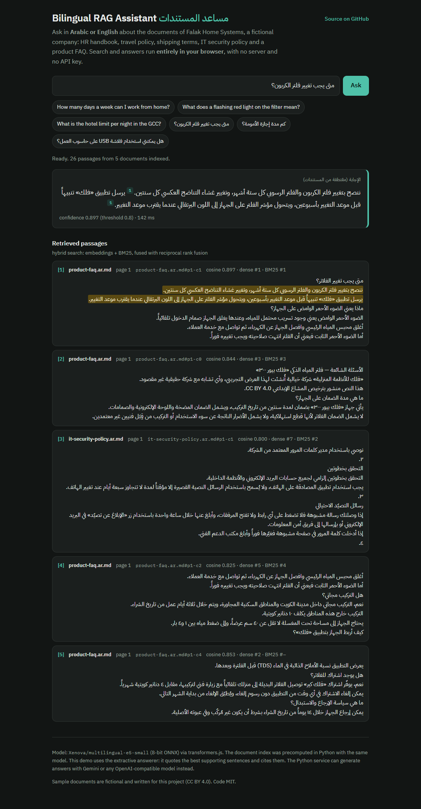
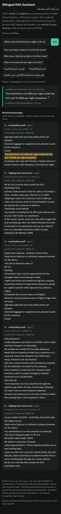
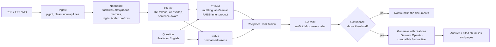

# Bilingual RAG Assistant — Arabic / English document Q&A with citations

Ask questions in **Arabic or English** about a set of documents and get an answer that **cites the exact passages** it
comes from, or an honest "not found in the documents". Hybrid retrieval (multilingual embeddings + BM25 with
Arabic-aware normalisation), cross-encoder re-ranking, and a pluggable generator (Gemini, any OpenAI-compatible
model, or a no-key extractive fallback), with an evaluation on 30 bilingual questions.

**▶ [Live demo](https://nardy11.github.io/bilingual-rag-assistant/)**: runs entirely in your browser, with no server
and no API key.

[](https://nardy11.github.io/bilingual-rag-assistant/)


[](LICENSE)



## What it does

- **Ingests PDF, TXT and Markdown** (pypdf), cleans the text, joins PDF line wraps, and splits it into
  sentence-aware chunks of at most 160 tokens of the embedding model's own tokenizer, with 40 tokens of overlap.
- **Normalises Arabic for matching**: removes tashkeel and tatweel, unifies alef forms (أ إ آ ٱ → ا), alef maqsura
  (ى → ي), taa marbuta (ة → ه) and hamza seats, maps Arabic-Indic digits, and strips the article and attached
  prefixes (ال، وال، بال…). Displayed text is never altered.
- **Retrieves with three methods**: dense (FAISS, `multilingual-e5-small`), BM25 (`rank_bm25`), and both fused with
  reciprocal rank fusion. A multilingual cross-encoder then optionally re-ranks the result.
- **Answers with citations**, `[1]`, `[2]`, each pointing at a chunk id (`travel-policy.en.pdf#p2-c0`) and a page.
  If the best passage is not similar enough to the question, it answers "Not found in the documents" /
  «لم أجد الإجابة في المستندات».
- **Serves it** as a FastAPI service (`/ingest`, `/ask`), a Docker image, a Gradio app for Hugging Face Spaces, and a
  static GitHub Pages demo that runs the same retrieval in the browser with transformers.js.



## Architecture



## Evaluation

`eval/questions.jsonl` holds **30 questions, 15 in Arabic and 15 in English**. Each has a gold document, a gold
evidence span and a short gold fact. 8 of them are **cross-lingual**: an English question whose answer sits in an
Arabic document, or the other way round. `eval/unanswerable.jsonl` adds 4 questions the documents cannot answer.
A retrieved chunk counts as gold if it comes from the gold document and contains the evidence span (compared after
normalisation). Reproduce with `python eval/run_eval.py`; raw per-question output is in
[`eval/results.json`](eval/results.json). CPU timings are from a Windows laptop.

**Retrieval** (26 chunks, k = 10):

| Retriever | Recall@1 | Recall@3 | Recall@5 | MRR@10 | R@5 EN | R@5 AR | R@5 cross-lingual | ms/query |
|---|---|---|---|---|---|---|---|---|
| BM25 | 0.63 | 0.77 | 0.77 | 0.689 | 0.80 | 0.73 | 0.12 | 0 |
| Dense (e5-small) | 0.70 | 0.87 | 0.90 | 0.795 | 0.93 | 0.87 | 0.75 | 24 |
| Hybrid (RRF) | 0.67 | 0.80 | 0.87 | 0.753 | 0.93 | 0.80 | 0.62 | 26 |
| Hybrid + rerank | 0.93 | 1.00 | 1.00 | 0.967 | 1.00 | 1.00 | 1.00 | 795 |

**End to end with the extractive generator** (no LLM, top 5 passages):

| Pipeline | Answered | Answer has the gold fact | Cites a gold passage | Abstained on unanswerable |
|---|---|---|---|---|
| Extractive, hybrid | 0.97 | 0.70 | 0.73 | 3/4 |
| Extractive, hybrid + rerank | 0.97 | 0.87 | 0.93 | 4/4 |

What the numbers say:

- **BM25 cannot cross languages.** It finds 1 of 8 cross-lingual gold passages in the top 5, against 6 of 8 for the
  multilingual embeddings. On same-language questions it is competitive, and it costs nothing.
- **On this corpus, plain RRF hybrid is slightly worse than dense alone.** Most of the gap comes from cross-lingual
  questions, where BM25 promotes same-language passages that share words with the question but do not answer it,
  and the fusion trusts them. I report it rather than tune the fusion weights on 30 questions. On a larger,
  single-language corpus with exact identifiers (product codes, clause numbers) the BM25 leg is what catches them.
- **The cross-encoder is the big win**: recall@1 goes from 0.67 to 0.93 and every gold passage lands in the top 3.
  It costs about 0.8 s per query on CPU for 20 candidates, which is fine for an assistant and is why re-ranking is
  on by default in the API and the Space. The browser demo skips it to stay light.
- **Confidence gating by cosine is weak with E5.** E5 cosines are compressed into a narrow band: the lowest
  answerable question scored 0.799 and the highest unanswerable 0.809. The 0.80 threshold
  refuses 3 of 4 out-of-scope questions with plain hybrid retrieval (4 of 4 after re-ranking) and wrongly
  refuses 1 answerable question, so it is a guard, not a guarantee. With an LLM generator, the prompt's own
  "reply exactly: not found" rule is the second gate.
- The set is small (30 + 4 questions over 26 chunks), so differences of one question (0.03) are noise.

## Design choices

**Why hybrid retrieval.** Embeddings handle paraphrase and cross-language questions; BM25 handles exact terms,
numbers and names that small embedding models blur. Reciprocal rank fusion combines the two rankings without
calibrating their score scales against each other. The evaluation shows where each one wins, and the cross-encoder
fixes the ordering that fusion gets wrong.

**Why `intfloat/multilingual-e5-small`.** It covers about 100 languages including Arabic, is among the strongest
multilingual retrievers of its size (118M parameters, 384 dimensions), and embeds a query in tens of milliseconds
on CPU. The same weights exist as an 8-bit ONNX export (`Xenova/multilingual-e5-small`), so the browser demo
embeds queries in exactly the vector space of the index precomputed in Python. Larger models (`bge-m3`,
`multilingual-e5-large`) retrieve better but are 5 to 20 times heavier and too large for a browser demo. They are
one environment variable away (`RAG_EMBED_MODEL`), but the confidence threshold needs re-calibrating.

**Why `cross-encoder/mmarco-mMiniLMv2-L12-H384-v1` for re-ranking.** It is a multilingual MiniLM trained on
mMARCO (14 languages, Arabic included) and is small enough to re-rank 20 passages on CPU in under a second.

**Arabic handling.** Arabic spelling varies in practice: hamza on alef is often dropped, ة and ه, and ى and ي
are swapped, and tashkeel is sometimes present. Matching therefore runs on a normalised form, while the
displayed text stays exactly as written. The light prefix stripping (ال، وال، بال، لل…) lets «الإجازة» match
«إجازة» in BM25 without a full stemmer that would over-conflate roots. Sentence splitting knows the Arabic
question mark «؟», and the demo renders every passage and answer with `dir="rtl"` when it is Arabic.

**Pluggable generation.** `RAG_LLM=gemini` (needs `GEMINI_API_KEY`), `RAG_LLM=openai` (any `/chat/completions`
endpoint: OpenAI, Groq, Together, vLLM, Ollama via `OPENAI_BASE_URL`, `OPENAI_API_KEY`, `OPENAI_MODEL`), or
`extractive`. Without any key the extractive generator is used: it quotes the one or two sentences from the top 3
passages that best match the question (0.75 × cosine + 0.25 × term overlap), so every word of the answer is
traceable. The LLM prompt requires `[n]` citations and the question's language, and the cited ids are parsed back
out of the answer.

## Security hardening

- **`/ingest` is admin-only.** It changes the index every user queries, so it is disabled unless `RAG_ADMIN_KEY` is
  set, and then requires that key in an `X-API-Key` header (constant-time comparison). Otherwise it returns 403.
- **Upload caps** in the API and the Space: at most 5 files per request, 10 MB per file (read in chunks, so it
  stops at the limit) and 200 PDF pages, otherwise 413. Configurable with `RAG_MAX_FILES`, `RAG_MAX_FILE_BYTES`
  and `RAG_MAX_PDF_PAGES`.
- **No HTML injection.** Document text is untrusted: the Gradio UI and the browser demo HTML-escape every answer and
  passage, and the `dir` attribute only ever takes the fixed values `rtl` or `ltr`.
- **Per-session uploads in the Space.** A visitor's documents go into a private copy of the index held in their
  session, so they never change what other visitors see.
- Tests cover all of the above (`tests/test_api.py`, `tests/test_render.py`).

## Model card and limits

- **Intended use:** question answering over a company's own policy, product and support documents, in Arabic
  and English, with a human able to check the cited passage.
- **Not for:** legal, medical or financial decisions without a human reading the source, or documents in other
  scripts or dialect-heavy text (not evaluated).
- **Known limits:**
  - The extractive answerer quotes sentences and does not compose answers across passages, so it answers "how
    long" better than "compare X and Y".
  - Arabic PDFs: pypdf's text extraction of Arabic depends on how the PDF was produced and can come out in the
    wrong order. Arabic sample documents are Markdown here, and a scanned or badly encoded Arabic PDF would need OCR.
  - The confidence threshold is calibrated for e5-small on this corpus.
  - The evaluation set is small and written by the author, from documents the author also wrote.
- **Data:** the sample corpus is fictional and written for this repo (CC BY 4.0, see [`data/README.md`](data/README.md)).
  No personal data.

## Quickstart

### Local

```bash
python -m venv .venv && source .venv/bin/activate      # Windows: .venv\Scripts\activate
pip install torch --index-url https://download.pytorch.org/whl/cpu
pip install -e ".[models,dev]"

python -m rag ask "كم مدة إجازة الأمومة؟" --rerank          # CLI
uvicorn rag.api:app --port 8000                             # API, docs at http://localhost:8000/docs
curl -X POST localhost:8000/ask -H "content-type: application/json" \
     -d '{"question": "What is the hotel limit per night in the GCC?"}'
RAG_ADMIN_KEY=change-me uvicorn rag.api:app --port 8000      # /ingest is off without an admin key
curl -X POST localhost:8000/ingest -H "X-API-Key: change-me" -F "files=@my-policy.pdf"

pytest -q && ruff check .                                   # tests need no model download and no key
python eval/run_eval.py                                     # the evaluation above
python scripts/export_web_index.py                          # rebuild docs/index.json for the browser demo
```

Set `GEMINI_API_KEY` (or `OPENAI_API_KEY` / `OPENAI_BASE_URL` / `OPENAI_MODEL`) to switch from extractive answers
to generated ones. `RAG_RERANK=0` turns re-ranking off, and `RAG_CORPUS_DIR` points the API at your own folder.

### Docker

```bash
docker build -t bilingual-rag .
docker run -p 8000:8000 -e GEMINI_API_KEY=... bilingual-rag     # the key is optional
```

### Hugging Face Space

`space/` holds the Gradio app (`app.py`), the Space README with its frontmatter, and `requirements.txt`. To deploy:

1. Create a free account at huggingface.co, then **New Space**: SDK *Gradio*, hardware *CPU basic*.
2. Clone the Space and copy in `space/app.py`, `space/README.md`, `space/requirements.txt`, and the `rag/` and
   `data/` folders (the app finds `rag/` next to itself).
3. `git add . && git commit -m "Deploy" && git push`. The first build downloads the models (~250 MB) and takes a
   few minutes.
4. Optional: add a `GEMINI_API_KEY` secret in the Space settings for generated answers.

## Use it for your business

Your policies, contracts, product manuals and support FAQs, in Arabic and English, become an assistant your team or
customers can ask in either language. It answers only from your documents, shows the passage it relied on, and says
so when the answer isn't there. It runs on your own server or a small cloud instance, works with the LLM of your
choice or with none, and comes with an evaluation set built from your real questions so quality is measured, not
assumed. Contact: [github.com/Nardy11](https://github.com/Nardy11).

## Project layout

```
rag/            normalize · ingest · chunking · embeddings · retrieval · rerank · generate · pipeline · api
eval/           questions.jsonl (30), unanswerable.jsonl (4), run_eval.py, results.json
docs/           GitHub Pages demo: index.html, app.js (browser port of the retriever), index.json
space/          Gradio app for Hugging Face Spaces
data/corpus/    sample documents (fictional, CC BY 4.0)
tests/          pytest: normalisation, chunking, retrieval on a tiny corpus, API
```

## License

Code: [MIT](LICENSE). Sample documents: CC BY 4.0. Models are used under their own licences:
`intfloat/multilingual-e5-small` (MIT) and `cross-encoder/mmarco-mMiniLMv2-L12-H384-v1` (Apache 2.0).
